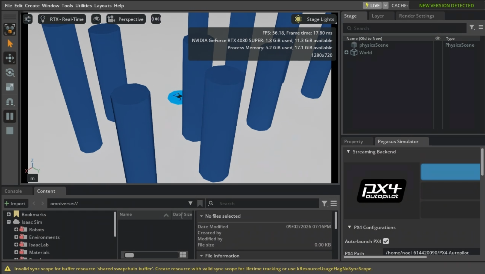

# 子型無人機之導航飛控
基於多幾何強化學習與模仿學習之無人機偵蒐視角決策與搜尋策略技術 -- 題目老師想好的

這個 Repository 用來記錄我的碩論跟中正大學孫計畫的開發，所以內容會隨研究進度持續調整，能否能畢業全看祂了，但現在看來還遙遙無期 --2026/09/02



## Repository の 結構

- `ros2_ws/src/`：目前使用中的 ROS 2 套件與各套件測試。
- `isaac/runtime/`：Isaac Sim / Pegasus 的主要執行環境與 pose bridge。
- `uav_ml/`：BC、ResNet、Autoencoder、Dataset、Inference 與 Evaluation 相關模組。
- `scripts/diagnostics/`：分析保存的閉環啟動紀錄。
- `tools/`：除錯、診斷與開發輔助工具。
- `tests/`：整個專案層級的 runtime 與 machine learning 測試。
- `docs/`：系統設計、問題紀錄、研究里程碑與開發文件。
- `datasets/`：專家資料集與影像。
- `experiments/`：Autoencoder、BC 模型與訓練結果。
- `evaluations/bc/`：Closed-loop 飛行測試結果。
- `artifacts/`：保留的舊資料、`bc_baseline` 與其他診斷輸出。

## Current workflows

Daily work should enter through `./uav`. The supported workflows are expert
collection (`expert-collect`), autoencoder training (`ae-train`), BC training
(`bc-train`), BC flight evaluation (`bc-eval`), and guarded PX4 SITL flight
(`px4-sitl-flight-check`). Readiness checks, timing diagnostics, and regression tests support these workflows.
The workspace has five ROS packages and two flight launch files; see [architecture](docs/architecture.md).

Use a profile for repeatable daily arguments without changing module defaults:

```bash
./uav profile current expert-collect
./uav profile current ae-train
./uav profile current bc-train
./uav profile current bc-eval --episodes 20
```

Profiles live in `config/profiles/`. They only supply workflow CLI arguments;
PX4 safety limits remain in the package ROS parameter YAML files.

The shared goal acceptance distance is `success_distance_m` in
[`uav_navigation/config/task.yaml`](ros2_ws/src/uav_navigation/config/task.yaml).
Edit that value once and restart the affected workflows to apply it to BC
evaluation, the PX4 flight supervisor, and Isaac goal confirmation. The flight YAML files inherit this default.
The shared Python loader reads and validates the YAML; it has no separate
distance default. Source-checkout ML workflows can read it without ROS or
launch. Installed ROS packages read the installed package's configuration.
Explicit ROS parameter or Python config overrides still take precedence.
Each workflow retains its existing distance calculation, comparison, and
additional acceptance conditions, including PX4 tracking and settling limits.
ROS deployments without symlink installation must rebuild `uav_navigation`
after changing the source setting. Build `uav_navigation` once after adding
the new YAML so it is included in the package installation.

AE and BC training can select a subset of usable episodes without changing the
source dataset. For example, select 50 episodes and split them into 30 training,
10 validation, and 10 held-out test episodes:

```bash
./uav ae-train --dataset cylinder_v4 --episodes 50 \
  --train-episodes 30 --validation-episodes 10 --test-episodes 10 --seed 7
./uav bc-train --dataset cylinder_v4 --episodes 50 \
  --train-episodes 30 --validation-episodes 10 --test-episodes 10 --seed 7
```

Use the same dataset, image sources, seed, and episode counts for AE and BC so
the encoder and policy share the same held-out episodes. Keep the dataset
unchanged between runs. BC automatically selects the latest compatible AE;
use `--encoder` to choose a specific checkpoint from the matching AE run.

All three split counts must be supplied together. Their sum determines the
total when `--episodes` is omitted, and must equal `--episodes` when supplied.
With only `--episodes 50`, the default split is 40/5/5. Without count options,
training continues to use all usable episodes with the existing 80/10/10 split.
Each split must contain at least one episode, and insufficient usable data is
reported as an error. Selection is reproducible with `--seed`; actual episode
IDs and unused usable episodes are saved in the run's `split_manifest.json`.
Dataset auditing still checks the full dataset before selecting the subset.
AE count options cannot be combined with the legacy `--split-file` option.

未來會考慮簡化資料結構

```bash
./uav expert-collect --episodes 100 --dataset bc_expert_cube
./uav expert-collect --episodes 100 --dataset bc_expert_cube --resume
./uav expert-collect --help
```

## 目前專案主要包含：

- Isaac Sim 無人機模擬環境
- Pegasus Simulator 整合
- PX4 OFFBOARD 飛行控制
- A* path planning
- FPV 與 observer camera
- Camera image recording
- ROS 2 pose 與飛行資料記錄
- Expert Dataset 自動蒐集
- Autoencoder 與 Behavior Cloning
- Closed-loop flight evaluation

## Notes

Dataset、rosbag、log、image、video、checkpoint 與其他實驗輸出不會丟到 github 上，畢竟現在是一坨 💩 。
